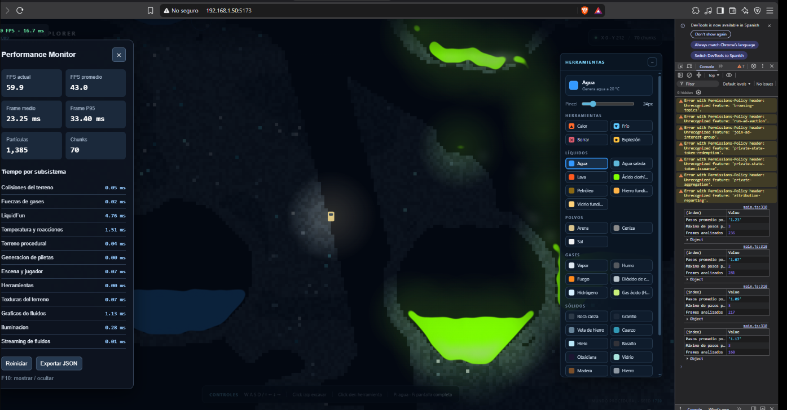
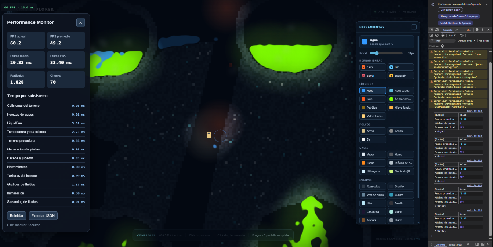
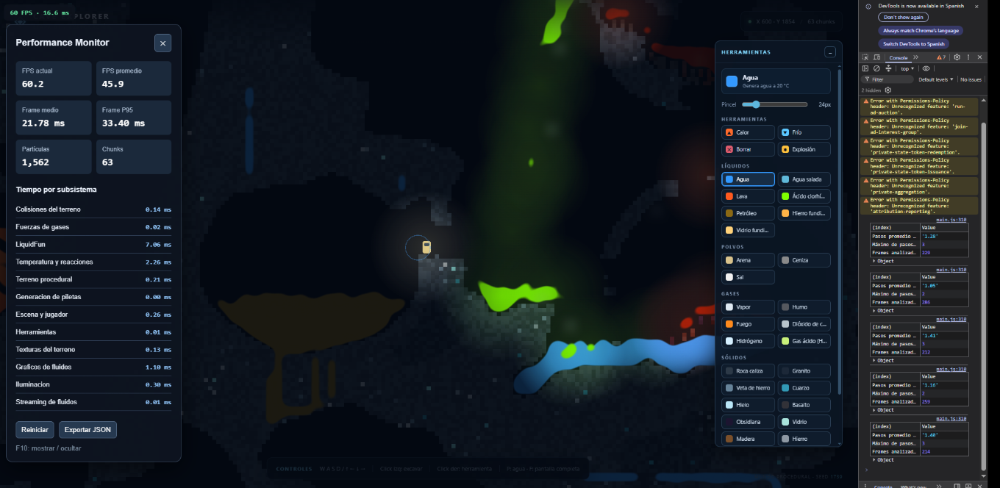
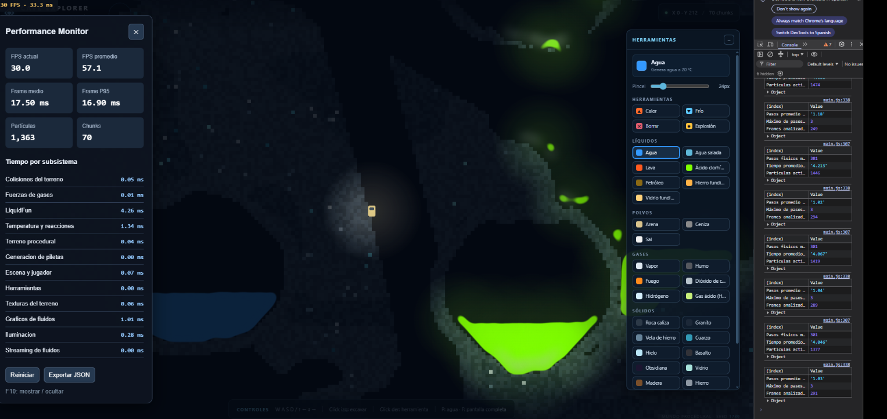
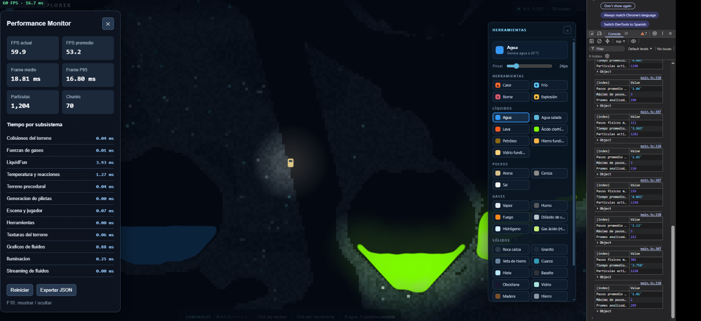
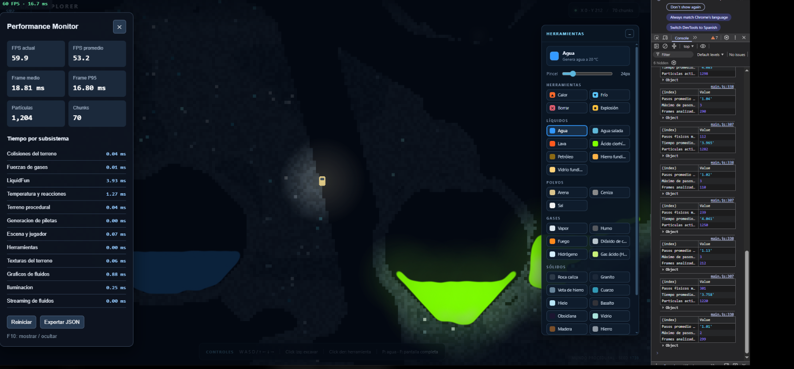
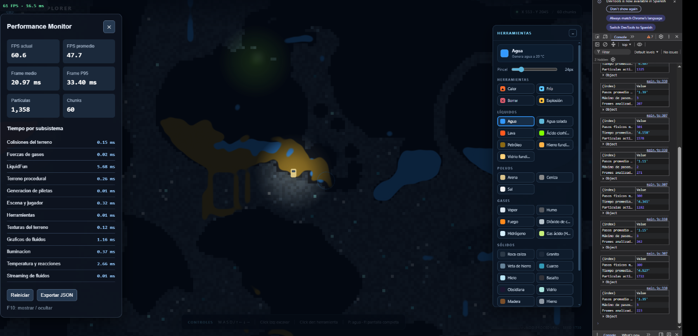

## Observación 1 – Análisis inicial de rendimiento (Benchmark)

Durante las pruebas de rendimiento de **Cave Explorer**, se registró una disminución de **58,1 a 35,6 FPS promedio** al aumentar la cantidad de partículas activas de **1.092 a 1.368**. LiquidFun presentó el mayor costo de procesamiento medido, aumentando de **4,42 ms a 6,24 ms por frame**, mientras que el sistema de temperatura y reacciones pasó de **1,20 ms a 2,51 ms**.

Por otro lado, la iluminación dinámica mantuvo un consumo bajo, entre **0,24 y 0,31 ms**. Los resultados sugieren que la física de partículas y las reacciones térmicas son los principales candidatos para futuras optimizaciones. Sin embargo, también será necesario analizar el renderizado y otros procesos no instrumentados para determinar las causas completas de la caída de FPS.

### Evidencia del benchmark

*Figura 1. Primera medición: 1.092 partículas activas, 70 chunks cargados y 58,1 FPS promedio.*

*Figura 2. Segunda medición: 1.368 partículas activas, 63 chunks cargados y 35,6 FPS promedio.*

### Conclusión

Las mediciones iniciales identifican a **LiquidFun y al sistema de temperatura y reacciones** como los principales candidatos de optimización entre los subsistemas instrumentados. Será necesario realizar pruebas controladas para determinar cuánto influye cada uno en el rendimiento general.

**Estado:** Benchmark inicial, previo a optimizaciones.

## Observación 2 – Diagnóstico de física y simulación

Se realizaron tres pruebas de rendimiento: personaje inactivo (AFK), desplazamiento por el mundo e interacción con el terreno y los fluidos.

Los FPS promedio registrados fueron de **43,0, 49,2 y 45,9**, respectivamente. LiquidFun presentó tiempos de **4,76 ms, 5,61 ms y 7,06 ms por frame**, alcanzando su mayor costo durante las interacciones con el entorno.

El contador de pasos físicos registró promedios aproximados de **1,05 a 1,41 pasos por frame**, con máximos de hasta 3 pasos. Esto confirma que el motor puede ejecutar múltiples actualizaciones físicas dentro de un mismo frame visual.

Se observó que el mayor tiempo de LiquidFun no coincidió con la mayor cantidad de partículas, lo cual sugiere que también pueden intervenir otros factores, como la complejidad de las colisiones y el número de pasos ejecutados.

**Conclusión:** se requiere medir el costo individual de `world.Step()` antes de modificar los algoritmos o parámetros físicos. Esto permitirá distinguir si el deterioro proviene del costo de cada paso o de la acumulación de varios pasos por frame.

**Estado:** Diagnóstico previo a optimización.

### Evidencias del Benchmark 2

**Prueba 1 – Personaje inactivo (AFK)**

*Figura 3. Prueba con el personaje inactivo: 1.385 partículas activas, 43,0 FPS promedio y 4,76 ms de LiquidFun.*

**Prueba 2 – Desplazamiento por el mundo**

*Figura 4. Prueba durante el desplazamiento: 1.828 partículas activas, 49,2 FPS promedio y 5,61 ms de LiquidFun.*

**Prueba 3 – Interacción con el terreno y los fluidos**

*Figura 5. Prueba de interacción: 1.562 partículas activas, 45,9 FPS promedio y 7,06 ms de LiquidFun.*

## Observación 3 – Análisis del costo por paso físico

Se realizaron nuevas mediciones de rendimiento para diferenciar el tiempo acumulado de LiquidFun por frame del costo individual de cada actualización física.

En los escenarios AFK se registraron **57,1 y 53,2 FPS promedio**, con tiempos de LiquidFun de **4,26 y 3,93 ms por frame**, respectivamente. Durante el desplazamiento, el rendimiento descendió a **47,7 FPS promedio**, mientras que LiquidFun aumentó a **5,68 ms por frame**.

Las mediciones individuales mostraron costos habituales cercanos a **3,8–4,5 ms por paso físico**, aunque también se detectó un pico considerablemente superior.

Por otro lado, el sistema de temperatura y reacciones aumentó de aproximadamente **1,3 ms a 2,66 ms por frame** durante el desplazamiento.

**Conclusión:** el rendimiento está condicionado tanto por el costo de los pasos físicos como por el procesamiento adicional de la simulación. Se propone analizar los algoritmos de temperatura y reacciones para identificar operaciones redundantes y oportunidades de optimización.

**Estado:** Análisis previo a la primera optimización algorítmica.

### Evidencia del Benchmark 3

#### Escenario 1 – Personaje inactivo (AFK)

*Figura 1. Primera medición del personaje inactivo, con 57,1 FPS promedio.*

*Figura 2. Segunda medición del personaje inactivo, con 53,2 FPS promedio.*

#### Escenario 2 – Desplazamiento por el mundo

*Figura 3. Medición durante el desplazamiento por cavernas procedurales.*

*Figura 4. Medición durante el desplazamiento e interacción, con 47,7 FPS promedio.*

## Observación 4 – Primera optimización del Spatial Hashing

Durante el análisis de `simulation.js`, se identificó que las coordenadas espaciales de cada partícula se calculaban dos veces por actualización térmica: primero durante la construcción de la grilla de Spatial Hashing y nuevamente durante la búsqueda de partículas vecinas.

Para eliminar esta redundancia, se incorporaron dos arreglos reutilizables (`GX` y `GY`), encargados de almacenar las coordenadas de cada partícula dentro de la grilla.

De esta manera, las coordenadas se calculan una sola vez y posteriormente se reutilizan durante la detección de vecinos.

Con aproximadamente **1.500 partículas activas**, esta modificación evita alrededor de **3.000 operaciones repetidas de cálculo de coordenadas por tick térmico**.

La optimización mantiene intactos los algoritmos de transferencia de calor, detección de contactos, reacciones y cambios de fase.

**Conclusión:** se eliminó un cálculo redundante dentro del Spatial Hashing, reduciendo el trabajo aritmético necesario para localizar partículas vecinas. Sin embargo, todavía no se ha demostrado una mejora cuantificable de FPS atribuible exclusivamente a esta modificación, debido a las diferencias entre los escenarios de prueba.

**Estado:** Optimización implementada. Impacto en el rendimiento pendiente de validación controlada.

---

## Observación 5 – Identificación de posibles cuellos de botella en la simulación térmica

Después de implementar la optimización anterior, se realizaron nuevas pruebas mediante el Performance Monitor, incorporando mediciones internas de `simulation.tick()` para analizar por separado las interacciones entre partículas y la difusión térmica del terreno.

Se evaluaron tres escenarios: personaje inactivo (AFK), desplazamiento por el mundo e interacción con el entorno.

### Resultados del Benchmark 5

| Métrica | AFK | Movimiento | Interacción |
|---|---:|---:|---:|
| FPS promedio | 45,3 | 43,6 | 39,5 |
| Partículas activas | 1.270 | 1.522 | 1.389 |
| LiquidFun | 3,19 ms | 7,40 ms | 7,88 ms |
| Temperatura y reacciones | 1,32 ms | 2,54 ms | 3,37 ms |
| Interacciones partícula-partícula | 0,59 ms | 0,82 ms | 0,95 ms |
| Difusión térmica del terreno | 0,34 ms | 0,94 ms | 1,50 ms |

Los resultados muestran que, entre el escenario AFK y el de interacción, el costo de las interacciones entre partículas aumentó aproximadamente un **61 %**, mientras que el procesamiento térmico del terreno aumentó aproximadamente un **341 %**.

Este último presentó el mayor crecimiento relativo entre las etapas internas analizadas, pasando de 0,34 ms a 1,50 ms por frame.

### Hipótesis sobre el problema de rendimiento

A partir del análisis de la función `updateCells()`, se plantea que el aumento del costo de procesamiento podría estar relacionado con la acumulación de celdas que mantienen información térmica.

Actualmente, esta función realiza las siguientes operaciones en cada actualización:

1. Obtiene las claves de las celdas térmicas mediante `Array.from(temps.keys())`.
2. Reserva un nuevo arreglo `Float64Array` para almacenar los resultados.
3. Crea un `Map` para acumular cambios de temperatura en celdas vecinas.
4. Recorre las celdas registradas y consulta hasta cuatro vecinos para calcular la difusión de calor.
5. Realiza un segundo recorrido para evaluar cambios de fase, temperatura y efectos visuales.

Se considera que, al desplazarse por nuevas regiones o interactuar con materiales calientes, podría aumentar la cantidad de celdas registradas en `terrain.cellTemp`, incrementando las consultas al terreno y las operaciones necesarias para actualizar sus temperaturas.

Además, la creación repetida de estructuras temporales podría generar trabajo adicional de asignación de memoria y recolección de basura.

Estas explicaciones constituyen **hipótesis de rendimiento**, no causas confirmadas.

### Próxima medición propuesta

Antes de modificar `updateCells()`, se propone registrar la cantidad de celdas térmicas activas mediante `terrain.cellTemp.size` y compararla con el tiempo de ejecución de `Sim - Terreno termico`.

Esto permitirá comprobar si existe una relación entre el crecimiento del estado térmico y el aumento del tiempo de procesamiento.

Posteriormente, se evaluarán posibles optimizaciones relacionadas con la reutilización de memoria, la reducción de consultas repetidas y el procesamiento de celdas que ya alcanzaron el equilibrio térmico.

**Conclusión:** el Benchmark 5 permitió identificar a la difusión térmica del terreno como un candidato prioritario de optimización dentro de `simulation.js`. Antes de realizar modificaciones, será necesario comprobar si su costo aumenta principalmente por la cantidad de celdas activas o por las operaciones ejecutadas sobre ellas.

**Estado:** Diagnóstico realizado. Hipótesis pendiente de verificación. Sin modificaciones aplicadas todavía a `updateCells()`.

## Observación 6 – Crecimiento de celdas térmicas y costo de simulación

Durante el análisis del sistema de temperatura de **Cave Explorer**, se realizaron tres pruebas: personaje inactivo (AFK), desplazamiento por el mundo e interacción con el terreno y los fluidos.

Se observó un crecimiento progresivo en la cantidad de celdas térmicas registradas:

| Escenario | Celdas iniciales | Celdas finales | Incremento |
|---|---:|---:|---:|
| AFK | 268 | 510 | +242 |
| Desplazamiento | 2.009 | 4.275 | +2.266 |
| Interacción | 305 | 4.827 | +4.522 |

El mayor crecimiento ocurrió durante las interacciones, donde la cantidad de celdas térmicas pasó de **305 a 4.827**, aproximadamente **15,8 veces el valor inicial**.

El análisis del código permitió identificar que la función `updateCells()` recorre las celdas con temperatura registrada para calcular la difusión de calor, evaluar cambios de fase y actualizar su estado. Además, realiza asignaciones de memoria mediante `Array.from()`, `Float64Array` y `Map` durante cada actualización térmica.

Estos resultados sugieren que el crecimiento de las celdas térmicas puede contribuir al aumento del costo de procesamiento observado en los benchmarks anteriores. Sin embargo, todavía es necesario medir los tiempos de ejecución junto con la cantidad de celdas para cuantificar esta relación.

### Conclusión

Se identifica la función `updateCells()` como candidata para la siguiente optimización. Se propone comenzar con la **reutilización del buffer de temperaturas**, buscando reducir las asignaciones de memoria sin modificar la transferencia de calor, los cambios de fase ni las reacciones existentes.

**Estado:** Diagnóstico previo a la optimización de memoria del sistema térmico.

Observación 6 – Reutilización de memoria en el sistema térmico

Se implementó la reutilización de un buffer Float64Array en la función updateCells(), evitando reservar un nuevo arreglo de temperaturas en cada actualización.

En las mediciones posteriores, el tiempo del subsistema térmico del terreno fue de 0,28 ms en AFK, 0,83 ms durante el desplazamiento y 1,00 ms durante las interacciones. Estos valores fueron inferiores a los registrados en las pruebas anteriores.

Sin embargo, debido a las diferencias en las condiciones de simulación, todavía no es posible atribuir la reducción exclusivamente a esta optimización. Se propone realizar una comparación controlada para verificar su impacto.

Estado: optimización implementada; mejora de rendimiento pendiente de validación.

## Observación 7 – Validación de reutilización de memoria del sistema térmico

Se realizó una prueba A/B para evaluar la reutilización del buffer `Float64Array` dentro de `updateCells()`, comparando la implementación original con una versión que conserva el arreglo entre actualizaciones.

En el escenario AFK, el tiempo promedio del terreno térmico fue de **0,276 ms sin reutilización y 0,288 ms con reutilización**. Durante el desplazamiento se registraron **0,591 ms y 0,874 ms**, respectivamente, mientras que durante las interacciones los tiempos fueron de **1,326 ms y 0,997 ms**.

Los resultados no evidencian una mejora consistente del rendimiento. Aunque la versión optimizada reduce las asignaciones repetidas de memoria, las diferencias en la cantidad de partículas y en el estado térmico del mundo impiden atribuir los cambios observados exclusivamente a esta modificación.

### Conclusión

La reutilización del buffer representa una mejora en la gestión de memoria, pero **su impacto sobre los FPS y el tiempo de procesamiento no pudo confirmarse** mediante las pruebas realizadas.

Se propone continuar el análisis de `updateCells()`, incorporando métricas sobre la cantidad de celdas térmicas procesadas y las consultas repetidas a sus vecinos.

**Estado:** optimización implementada; beneficio de rendimiento no concluyente.

## Observación 7 – Análisis de celdas térmicas y consultas a vecinos

Se incorporaron contadores en `updateCells()` para medir la cantidad de celdas térmicas procesadas y las consultas realizadas a sus vecinos durante la difusión de calor.

Los resultados evidenciaron una diferencia significativa entre las celdas registradas y las consultas efectuadas:

| Escenario | Celdas térmicas procesadas | Consultas a vecinos |
|---|---:|---:|
| AFK | 0 | 0 |
| Movimiento | 2.288 | 0 |
| Movimiento e interacción | 5.071 | 1.220 |

*Los valores corresponden a los últimos registros de cada escenario.*

Durante el desplazamiento se observaron 2.288 celdas procesadas sin ninguna consulta a vecinos. En el escenario de interacción, se registraron 5.071 celdas y 1.220 consultas, considerablemente menos que las 20.284 consultas teóricas que resultarían de evaluar cuatro vecinos por cada celda.

El análisis de `updateCells()` permitió identificar que las celdas cuyo material es inválido o no está cargado se omiten mediante una instrucción `continue`, evitando ejecutar el bucle de difusión.

Esto sugiere que una parte del mapa térmico podría contener registros correspondientes a celdas vacías o descargadas. Aunque estas celdas no realizan cálculos con sus vecinos, siguen participando en el recorrido inicial de la función.

### Conclusión

Se identificó una posible oportunidad de optimización relacionada con la administración de las celdas térmicas registradas.

Como siguiente paso, se incorporó el contador `lastSkippedThermalCells` para determinar cuántas celdas son omitidas durante cada actualización.

Esta información permitirá evaluar si es posible reducir recorridos innecesarios sin afectar la persistencia de la temperatura, la difusión de calor ni los cambios de fase.

**Estado:** diagnóstico en curso; pendiente de medir las celdas térmicas omitidas.

## Observación 7 – Diagnóstico final del procesamiento térmico previo a la optimización

Se incorporaron métricas adicionales en `updateCells()` para identificar el origen de las celdas térmicas omitidas durante la simulación.

Los resultados permitieron comprobar que las celdas omitidas corresponden a **chunks descargados**, cuyas temperaturas permanecen almacenadas en `terrain.cellTemp` para conservar el estado térmico del mundo.

| Métrica | Movimiento | Movimiento e interacción |
|---|---:|---:|
| Celdas procesadas | 2.012 | 2.737 |
| Celdas descargadas | 2.010 | 2.231 |
| Celdas vacías | 0 | 0 |
| Celdas válidas para difusión | 2 | 506 |
| Consultas a vecinos | 8 | 2.024 |
| Porcentaje de celdas omitidas | 99,9 % | 81,5 % |

*Valores correspondientes al último registro de cada escenario.*

### Conclusión

El análisis permitió identificar una ineficiencia en la arquitectura del sistema térmico: `updateCells()` recorre todas las temperaturas registradas, incluso aquellas pertenecientes a chunks que ya no están cargados.

Durante el desplazamiento, el **99,9 % de las celdas recorridas** correspondía a chunks descargados, mientras que durante las interacciones este porcentaje alcanzó el **81,5 %**.

Aunque estas celdas no realizan cálculos de difusión, siguen generando trabajo mediante su recorrido, consulta y clasificación.

Como siguiente optimización, se propone implementar un sistema de **indexación de temperaturas por chunk**, permitiendo procesar únicamente las celdas pertenecientes a regiones cargadas y conservar las temperaturas de los chunks descargados para mantener la persistencia del mundo.

Esta modificación busca reducir el costo computacional de `updateCells()` sin alterar la transferencia de calor, las reacciones ni los cambios de fase.

**Estado:** diagnóstico completado. Optimización por chunks pendiente de implementación y validación mediante benchmarks A/B.

### Observación adicional – Mejora en la estabilidad del rendimiento

Tras implementar la indexación de temperaturas por chunks, se observó una mejora perceptible en la estabilidad de los FPS durante la exploración.

Anteriormente, el juego podía permanecer varios segundos alrededor de los 30 FPS. Después de la optimización, las caídas continuaron apareciendo ocasionalmente, pero su duración percibida se redujo a aproximadamente un segundo, recuperándose posteriormente hasta los 60 FPS.

Esta observación coincide con la reducción del trabajo realizado por `updateCells()`, que ahora evita recorrer las temperaturas de chunks descargados.

Aunque la mejora fue perceptible durante las pruebas, todavía se requiere una comparación controlada de los tiempos de ejecución y la duración de las caídas de FPS para cuantificar su impacto.

**Resultado preliminar:** menor duración percibida de las caídas de rendimiento y recuperación más rápida de los FPS.

## Observación 8 – Optimización del sistema térmico mediante indexación por chunks

Se implementó una optimización en el sistema de temperaturas de Cave Explorer mediante la indexación de celdas térmicas por chunk.

Anteriormente, la función `updateCells()` recorría todas las temperaturas almacenadas, incluyendo las pertenecientes a chunks descargados. Los benchmarks previos permitieron identificar escenarios donde más del 99 % de las celdas recorridas no participaba en la difusión térmica.

La nueva implementación mantiene las temperaturas almacenadas, pero selecciona únicamente las celdas de los chunks cargados para su actualización.

### Resultados de rendimiento

| Métrica | Movimiento | Movimiento e interacción |
|---|---:|---:|
| FPS promedio | 58,92 | 50,00 |
| Tiempo promedio por frame | 16,97 ms | 20,00 ms |
| Frame P95 | 16,80 ms | 33,40 ms |
| Terreno térmico | 0,051 ms | 0,589 ms |
| LiquidFun | 3,07 ms | 5,19 ms |

En movimiento, solamente el 1,7 % de los 600 frames analizados alcanzó una duración de 30 ms o más.

Durante las interacciones, el porcentaje fue del 19,2 %, evidenciando que todavía existen caídas de rendimiento bajo mayor carga.

### Validación funcional

Se comprobó que las temperaturas permanecen almacenadas durante la descarga de chunks. En una prueba de diez segundos fuera de la zona caliente no se detectaron temperaturas modificadas ni registros eliminados.

Al regresar a la zona, el sistema volvió a procesar 393 celdas térmicas y realizó 1.572 consultas a vecinos.

Posteriormente, se observaron 473 temperaturas modificadas y seis registros eliminados, confirmando que el sistema reanudó la actualización térmica.

### Conclusión

La optimización permitió eliminar recorridos innecesarios sobre temperaturas de chunks descargados, conservando su información para cuando el jugador regrese.

Los resultados posteriores muestran un rendimiento favorable, especialmente durante el desplazamiento, con un promedio cercano a 60 FPS y pocas caídas prolongadas.

Si bien las diferencias entre las condiciones de los benchmarks impiden cuantificar con precisión la mejora global atribuible a esta optimización, se verificó la reducción del trabajo de recorrido y el correcto funcionamiento de la persistencia térmica.

**Estado:** optimización implementada y validación funcional satisfactoria. Mejora exacta de rendimiento pendiente de comparación controlada.